<p align="center">
  
</p>

<h1 align="center">Instalar Home</h1>

<p align="center">
  Take your Askey RG3205W from stock to <a href="https://github.com/daniel1286/home-rom-rg3205w">Home</a> · LineageOS 22 · Android 15
</p>

<p align="center">
  <a href="https://github.com/daniel1286/home-instalador-rg3205w/releases/latest"></a>
  
  
  
</p>

<p align="center">
  <a href="#usb-cable-windows">🔌 USB cable</a>
  &nbsp;·&nbsp;
  <a href="#wireless-raspberry-pi">📡 Wireless</a>
  &nbsp;·&nbsp;
  <a href="https://github.com/daniel1286/home-rom-rg3205w">Home ROM</a>
  &nbsp;·&nbsp;
  <a href="README.md">Español</a>
</p>

---

Two ways to install Home. Pick the one that works for you:

| | 🔌 USB cable | 📡 Wireless |
|---|---|---|
| **You need** | Windows PC + USB cable | Raspberry Pi 3B+ |
| **Touch the device** | Yes (open + USB) | No (everything over WiFi) |
| **Difficulty** | Easy | Medium |
| **Time** | ~15 min | ~25 min (Pi) + ~10 min |

> [!WARNING]
> Installing Home wipes all data on the device. Changing the software may void the warranty.

> [!NOTE]
> The installer window and the Pi control panel are in Spanish. The steps below explain everything in English.

---

# USB cable (Windows)

A single `.exe` that does everything: downloads Home, checks integrity, sets up Windows and flashes it.

<p align="center">
  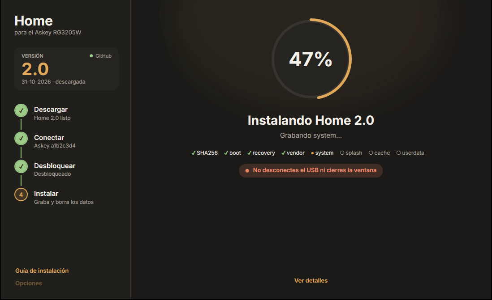
</p>

### 📥 Steps

1. **Download** → [Instalar-Home.exe](https://github.com/daniel1286/home-instalador-rg3205w/releases/latest/download/Instalar-Home.exe)
2. **Open** it — if Windows says "protected your PC", click _More info → Run anyway_
3. **Follow** the steps in the window

> [!TIP]
> Already have the Home zip? **Opciones → Elegir zip** to use it without downloading again.

<details>
<summary>📸 <b>Full process screenshots</b></summary>
<br>

<table>
  <tr>
    <td width="50%">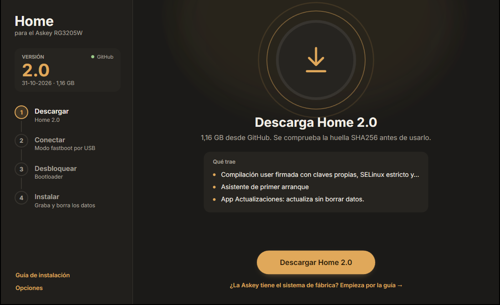</td>
    <td width="50%">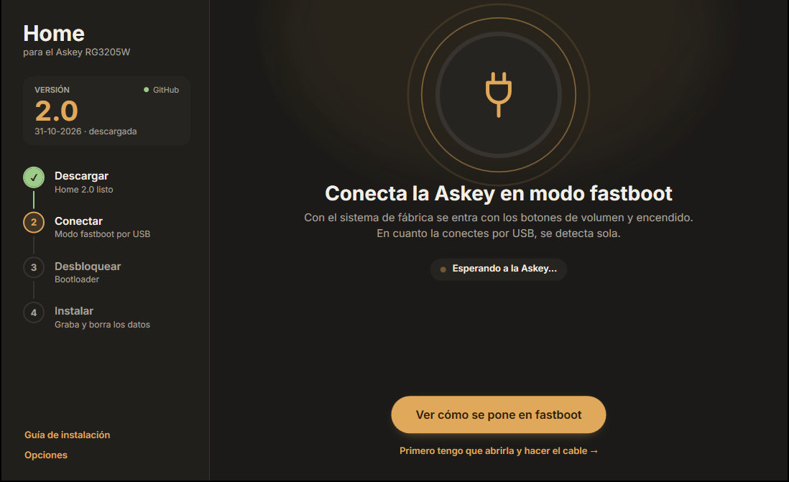</td>
  </tr>
  <tr>
    <td><b>1. Download</b> (<i>Descargar</i>). Finds the latest version, downloads it and checks SHA256.</td>
    <td><b>2. Connect</b> (<i>Conectar</i>). Auto-detects the Askey in fastboot mode.</td>
  </tr>
  <tr>
    <td>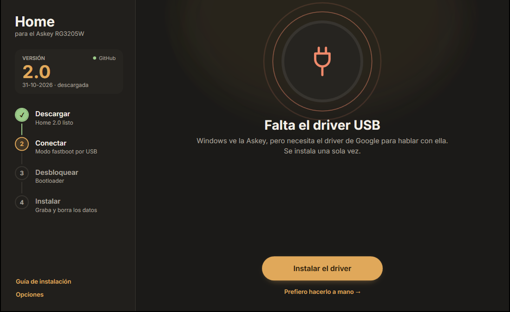</td>
    <td>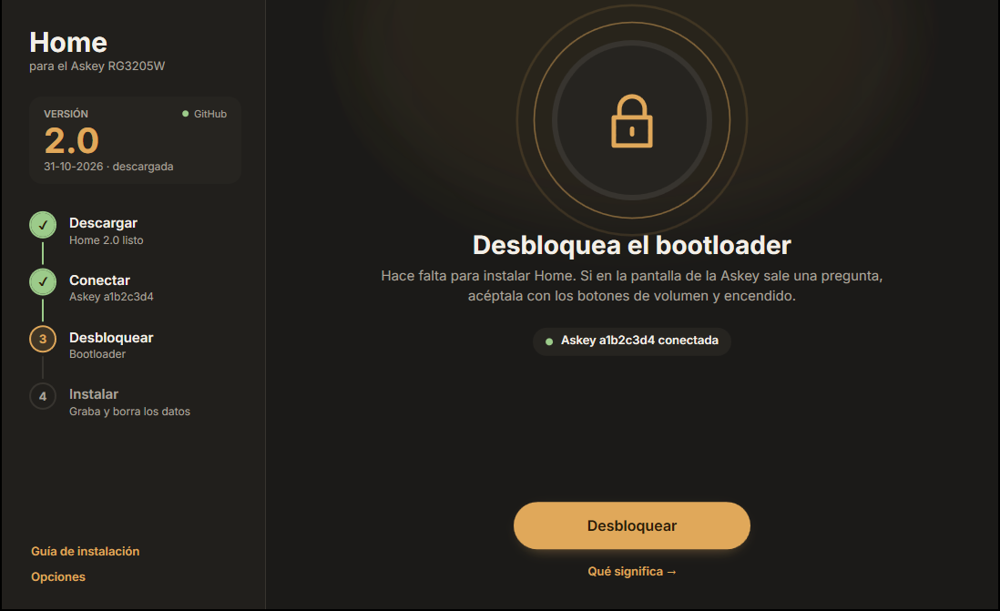</td>
  </tr>
  <tr>
    <td><b>USB driver.</b> Downloads and installs it in one click if missing.</td>
    <td><b>3. Unlock</b> (<i>Desbloquear</i>). Unlocks the bootloader if needed.</td>
  </tr>
  <tr>
    <td>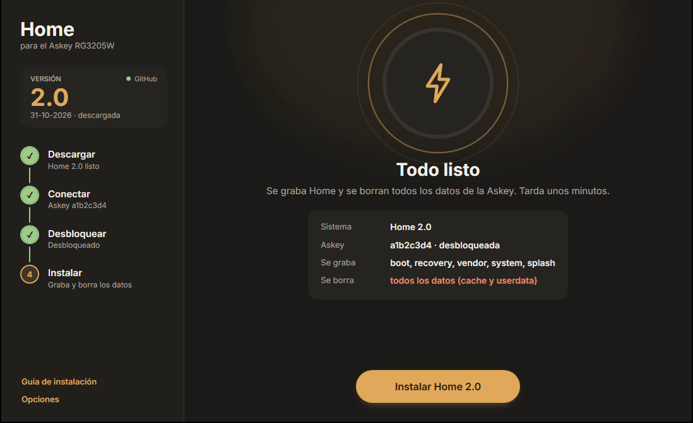</td>
    <td>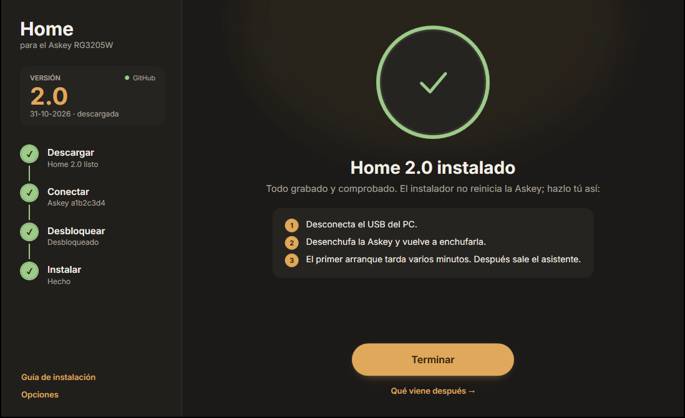</td>
  </tr>
  <tr>
    <td><b>4. Install</b> (<i>Instalar</i>). Flashes each image with progress.</td>
    <td><b>Done.</b> Reboot and the Home setup wizard appears.</td>
  </tr>
</table>

<br>

The guide for opening the device, making the cable and entering fastboot is built into the installer:

<p align="center">
  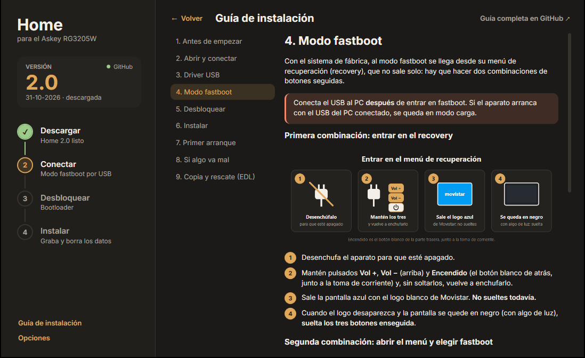
</p>

<p align="center">
  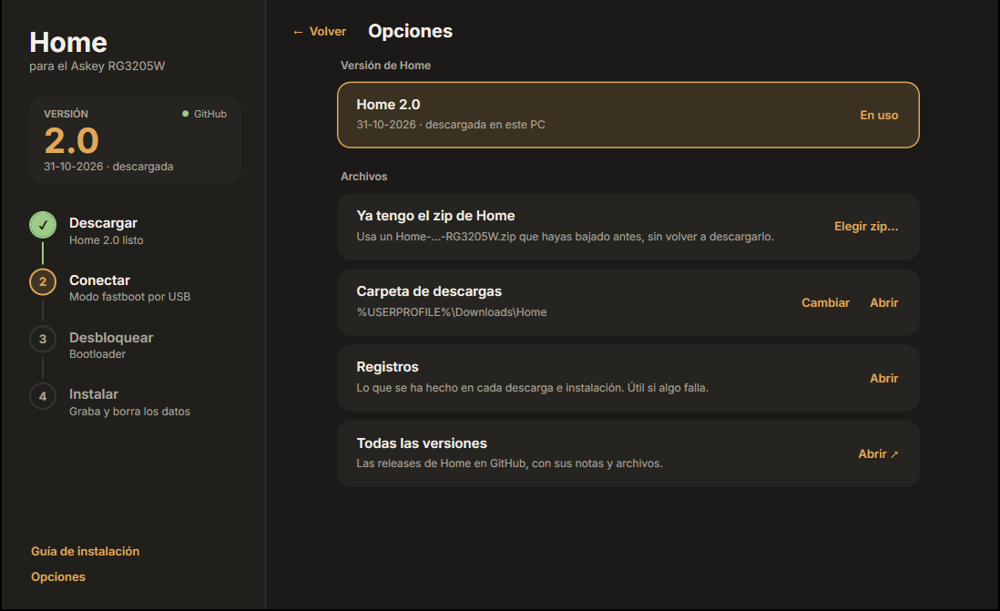
</p>

</details>

<details>
<summary>📋 <b>Requirements</b></summary>
<br>

- 64-bit Windows 10/11 with .NET Framework 4.8 (ships with Windows)
- Internet to download Home, fastboot and the driver · ~4 GB free
- Askey RG3205W (Rev4 or Rev5) + cable ([which one](https://github.com/daniel1286/home-rom-rg3205w/blob/main/guias/INSTALL.md#2-rev4-or-rev5-and-connecting-it-to-the-pc))

</details>

<details>
<summary>🔒 <b>What it touches and what it doesn't</b></summary>
<br>

- Only flashes `boot`, `recovery`, `vendor`, `system` and `splash`, only formats `cache` and `userdata`
- Checks the device is an RG3205W, still the same one and still unlocked
- Won't flash if SHA256 or size doesn't match
- Never restarts the Askey or relocks the bootloader
- Stores its files in `%LOCALAPPDATA%\Home\Instalador` · Home in `Downloads\Home`

</details>

<details>
<summary>❓ <b>FAQ</b></summary>
<br>

**Why does "Windows protected your PC" show up?**
Windows shows it for unsigned, rarely downloaded programs. Check SHA256 from each [release](https://github.com/daniel1286/home-instalador-rg3205w/releases/latest):
```powershell
Get-FileHash .\Instalar-Home.exe -Algorithm SHA256
```

**Do I need to run it as administrator?**
No. It only asks for elevation to install the USB driver.

**How do I remove it?**
Delete `Instalar-Home.exe` and `%LOCALAPPDATA%\Home\Instalador`.

**Something went wrong.**
Open an [issue](https://github.com/daniel1286/home-instalador-rg3205w/issues/new/choose) with the log from **Opciones → Registros**.

**Can I do it manually?**
Yes → [manual guide](https://github.com/daniel1286/home-rom-rg3205w/blob/main/guias/INSTALL.md).

</details>

<details>
<summary>🔨 <b>Building</b></summary>
<br>

With the C# compiler shipped with Windows (.NET Framework 4.8):

```
compilar.cmd
```

Result: `salida\Instalar-Home.exe`. GitHub Actions builds on every push; a `vX.Y` tag triggers a release.

Demo mode (no device needed):
```
set INSTALADOR_DEMO=instalando
salida\Instalar-Home.exe
```

| File | Purpose |
|---|---|
| `fuente/Programa.cs` | Entry point, single instance |
| `fuente/Ventana.xaml` · `Ventana.cs` | Window and UI |
| `fuente/Pantallas.cs` · `Acciones.cs` | Screens and button actions |
| `fuente/Trabajos.cs` | Download, driver, unlock, flash |
| `fuente/Red.cs` | GitHub releases and resumable downloads |
| `fuente/Imagenes.cs` | Extract and verify images |
| `fuente/Fastboot.cs` | Locate and run fastboot |
| `fuente/Guia.cs` · `Piezas.cs` | Built-in installation guide |
| `fuente/Rutas.cs` · `Estado.cs` | Paths and shared state |

</details>

---

# Wireless (Raspberry Pi)

No need to open the device or plug in cables. A Raspberry Pi acts as a local backend: the device connects to its WiFi, receives the update and boots into Home. **Fully automatic.**

<p align="center">
  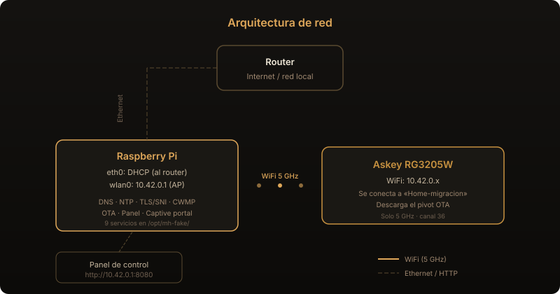
</p>

<details>
<summary>🔄 <b>See the step-by-step process</b></summary>
<br>

After a factory reset, the device tries to reach the original servers — but the Pi answers instead: it resolves all domains to itself, serves the APIs the firmware expects and delivers an OTA pivot (a minimal ~1 MB recovery image). The device installs it, reboots into that recovery and from there downloads and installs the full Home ROM. Two phases, both automatic.

<p align="center">
  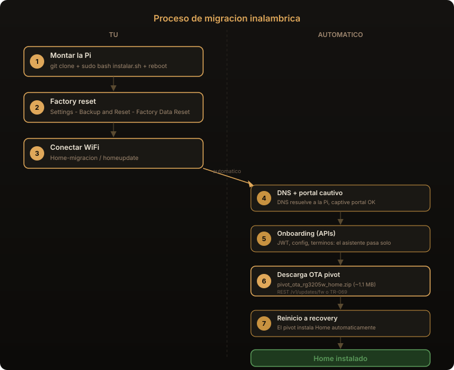
</p>

</details>

### ⚙️ Set up the Pi

**1.** Flash Raspberry Pi OS to the SD card and connect the Pi to the router via ethernet

**2.** Clone and install:

```bash
git clone https://github.com/daniel1286/home-instalador-rg3205w.git
cd home-instalador-rg3205w/inalambrico
sudo bash instalar.sh
```

> [!NOTE]
> The script installs packages, sets up the 5 GHz WiFi access point, generates TLS certificates, installs the 9 backend services and downloads the OTA files from Releases.

**3.** Reboot: `sudo reboot` — the backend starts automatically.

### 📱 Migrate the device

| Step | What to do |
|:---:|---|
| **1** | 🔄 Factory reset → _Settings → Backup & Reset → Factory Data Reset_ |
| **2** | 📶 Connect to WiFi → Network: **`Home-migracion`** · Password: **`homeupdate`** |
| **3** | ⏳ Automatic — downloads OTA, reboots, installs Home |

<details>
<summary>🖥️ <b>Control panel</b></summary>
<br>

From any browser on the Pi's network:

> **http://10.42.0.1:8080**

Shows active services, connected device, OTA progress and the live log.

</details>

<details>
<summary>🔧 <b>Services and configuration</b></summary>
<br>

9 services that start automatically with the Pi:

| Service | Port | Purpose |
|---|---|---|
| `hostapd` | wlan0 | WiFi 5 GHz AP (channel 36) |
| `dnsmasq` | 53 | DNS → redirects domains to backend + DHCP |
| `mh-sni` | 443 | TLS/SNI → firmware API endpoints (77) |
| `mh-captive` | 80 | Captive portal → returns 204 |
| `mh-ntp` | 123/UDP | NTP → fixed date for cert validity |
| `mh-cwmp` | 7016 | TR-069 TLS → delivers OTA to device |
| `mh-cwmp-http` | 7006 | TR-069 HTTP → fallback |
| `mh-ota` | 8000 | HTTP server for OTA files |
| `mh-panel` | 8080 | Web control panel |

**Configuration** → `/etc/default/mh-fake`:

| Variable | Value | Purpose |
|---|---|---|
| `MH_MODE` | `ota` | Normal mode: delivers OTA pivot + Home ROM |
| `MH_MODE` | `onboarding` | Wizard only, no OTA (for testing) |

Change mode:
```bash
sudo sed -i 's/MH_MODE=.*/MH_MODE=onboarding/' /etc/default/mh-fake
sudo systemctl restart mh-sni mh-cwmp mh-cwmp-http
```

SSID/password → `/etc/hostapd/hostapd.conf` → `sudo systemctl restart hostapd`

</details>

<details>
<summary>📋 <b>Requirements</b></summary>
<br>

- **Raspberry Pi 3B+ or better** with 5 GHz WiFi (the RG3205W only connects on 5 GHz)
- **Raspberry Pi OS** (Lite is fine)
- **Ethernet cable** to the router (only during Pi setup)
- OTA files are downloaded automatically by the install script, or from [Releases](https://github.com/daniel1286/home-instalador-rg3205w/releases)

</details>

<details>
<summary>📂 <b>File structure</b></summary>
<br>

```
inalambrico/
├── instalar.sh                 install script
└── backend/
    ├── sni_server.py           TLS/SNI (77 endpoints)
    ├── cwmp_server.py          TR-069 ACS (delivers OTA in 2 phases)
    ├── captive_server.py       captive portal
    ├── ota_server.py           HTTP server for OTAs
    ├── ntp_server.py           NTP server
    ├── generate_certs.py       certificate generator
    ├── panel_server.py         control panel
    ├── panel.html              panel UI
    ├── run-sni.sh              SNI launcher
    ├── run-cwmp.sh             ACS TLS launcher
    ├── run-cwmp-http.sh        ACS HTTP launcher
    ├── config/
    │   ├── hostapd.conf        WiFi 5 GHz AP
    │   ├── dnsmasq.conf        DNS + DHCP
    │   └── backend.default     environment variables
    └── systemd/                service units
```

On the Pi: `/opt/mh-fake/` · Certs: `/opt/mh-fake/certs/` · OTAs: `/opt/mh-fake/otas/`

</details>

<details>
<summary>❓ <b>FAQ</b></summary>
<br>

**Which Pi models work?**
Any with 5 GHz WiFi: Pi 3B+ (ac), Pi 4, Pi 5. Pi 3B and Pi Zero **don't** (2.4 GHz only).

**What is the OTA pivot?**
A minimal recovery image (~1 MB) that opens the door. It's not Home itself — it just prepares the device so the Pi can deliver the full Home ROM automatically in a second phase.

**Do I need internet during migration?**
No. Only during Pi setup. After that it works on the Pi's own local network with no internet.

**Can I migrate multiple devices?**
Yes. Each factory reset + WiFi connection starts the process. The backend resets automatically.

**The device connects but nothing happens.**
Check the 9 services:
```bash
sudo systemctl status mh-sni mh-captive mh-ntp mh-cwmp mh-cwmp-http mh-ota mh-panel hostapd dnsmasq
```
If any fail → `journalctl -u mh-sni -f`

**Can I change the SSID and WiFi password?**
Yes → edit `/etc/hostapd/hostapd.conf` → `sudo systemctl restart hostapd`

</details>

---

<details>
<summary><b>Credits</b></summary>
<br>

- [Inter](https://rsms.me/inter/), by Rasmus Andersson — [SIL Open Font License 1.1](recursos/letras/OFL.txt)
- Board photos: [zry98/movistar-home-hacks](https://github.com/zry98/movistar-home-hacks)
- fastboot and Google USB Driver are downloaded from Google when needed

</details>

**[Apache License 2.0](LICENSE)**

<p align="center">
  <sub>Independent project, not affiliated with Askey or any carrier. All trademarks belong to their respective owners.</sub>
</p>
