<p align="center">
  
</p>

<h1 align="center">Instalar Home</h1>

<p align="center">
  Lleva tu Askey RG3205W de fábrica a <a href="https://github.com/daniel1286/home-rom-rg3205w">Home</a> · LineageOS 22 · Android 15
</p>

<p align="center">
  <a href="https://github.com/daniel1286/home-instalador-rg3205w/releases/latest"></a>
  
  
  
</p>

<p align="center">
  <a href="#por-cable-windows">🔌 Por cable</a>
  &nbsp;·&nbsp;
  <a href="#inalámbrico-raspberry-pi">📡 Inalámbrico</a>
  &nbsp;·&nbsp;
  <a href="https://github.com/daniel1286/home-rom-rg3205w">Home ROM</a>
  &nbsp;·&nbsp;
  <a href="README.en.md">English</a>
</p>

---

Dos formas de instalar Home. Elige la que te venga mejor:

| | 🔌 Por cable | 📡 Inalámbrico |
|---|---|---|
| **Necesitas** | PC Windows + cable USB | Raspberry Pi 3B+ |
| **Tocas el aparato** | Sí (abrir + USB) | No (todo por WiFi) |
| **Dificultad** | Baja | Media |
| **Tiempo** | ~15 min | ~25 min (Pi) + ~10 min |

> [!WARNING]
> Instalar Home borra todos los datos del dispositivo. Cambiar el software puede anular la garantía.

---

# Por cable (Windows)

Un `.exe` que lo hace todo: descarga Home, comprueba que no se ha dañado, prepara Windows y lo instala.

<p align="center">
  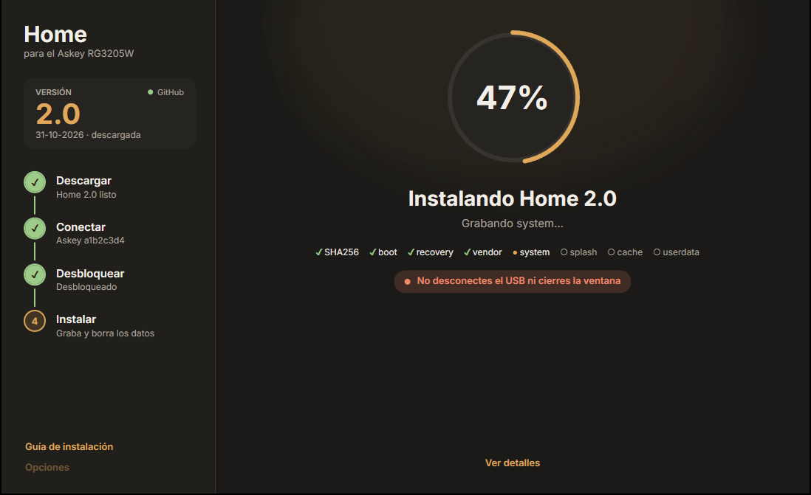
</p>

### 📥 Pasos

1. **Descarga** → [Instalar-Home.exe](https://github.com/daniel1286/home-instalador-rg3205w/releases/latest/download/Instalar-Home.exe)
2. **Abre** el `.exe` — si Windows dice «protegió su PC», pulsa _Más información → Ejecutar de todas formas_
3. **Sigue** los pasos de la ventana

> [!TIP]
> Si ya tienes el zip de Home: **Opciones → Elegir zip** para usarlo sin descargar otra vez.

<details>
<summary>📸 <b>Capturas del proceso completo</b></summary>
<br>

<table>
  <tr>
    <td width="50%">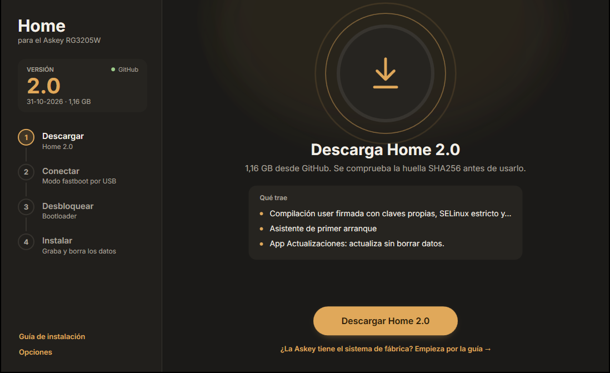</td>
    <td width="50%">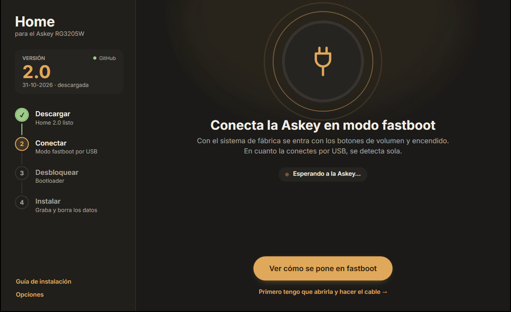</td>
  </tr>
  <tr>
    <td><b>1. Descargar.</b> Busca la última versión, la descarga y comprueba SHA256.</td>
    <td><b>2. Conectar.</b> Detecta sola la Askey en modo fastboot.</td>
  </tr>
  <tr>
    <td>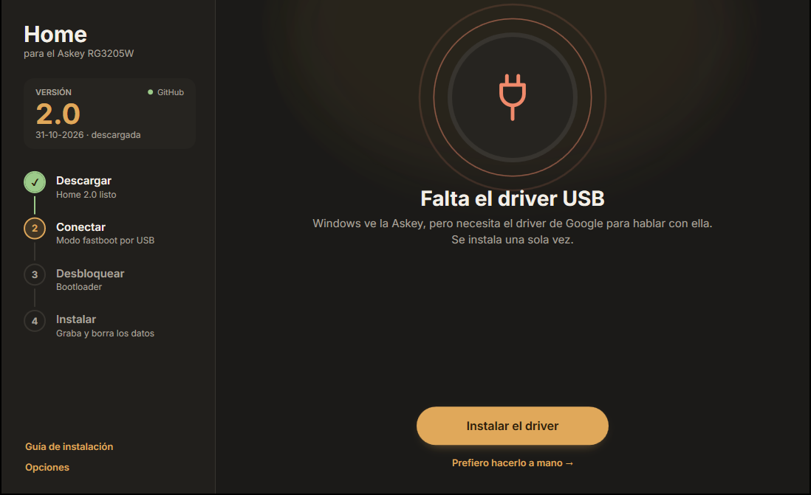</td>
    <td>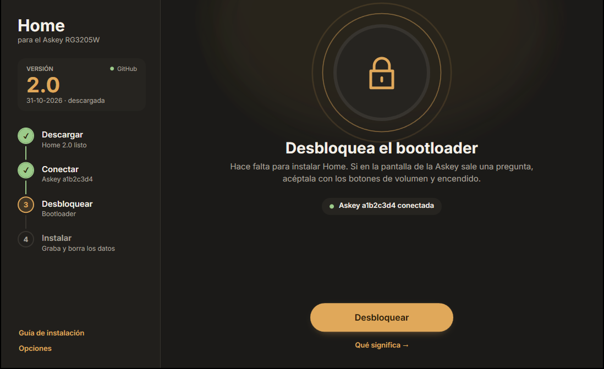</td>
  </tr>
  <tr>
    <td><b>Driver USB.</b> Lo descarga e instala con un clic si falta.</td>
    <td><b>3. Desbloquear.</b> Desbloquea el bootloader si hace falta.</td>
  </tr>
  <tr>
    <td>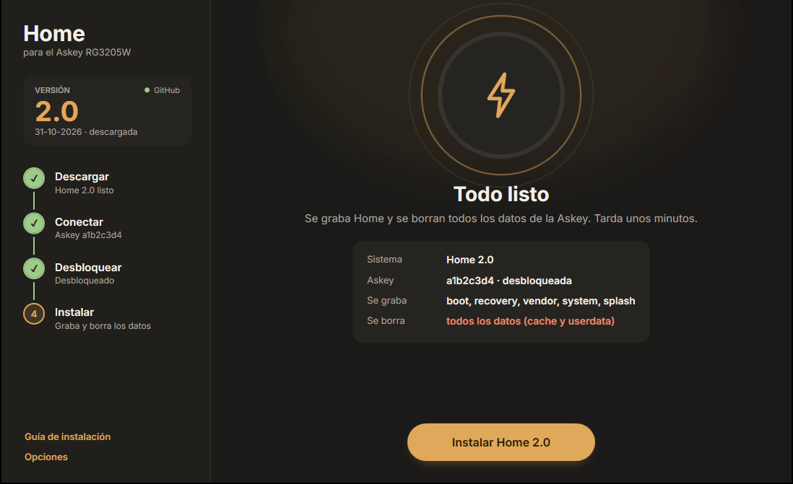</td>
    <td>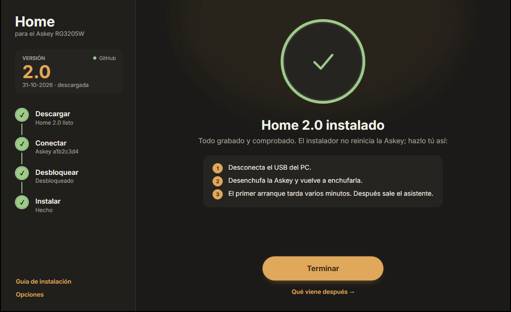</td>
  </tr>
  <tr>
    <td><b>4. Instalar.</b> Graba cada imagen mostrando el progreso.</td>
    <td><b>Hecho.</b> Reinicia y sale el asistente de Home.</td>
  </tr>
</table>

<br>

La guía para abrir el aparato, hacer el cable y entrar en fastboot viene dentro del instalador:

<p align="center">
  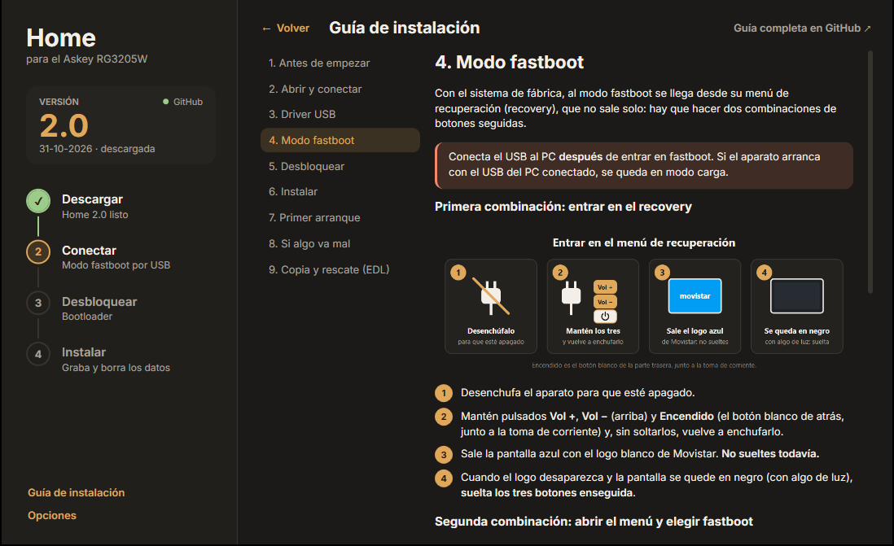
</p>

<p align="center">
  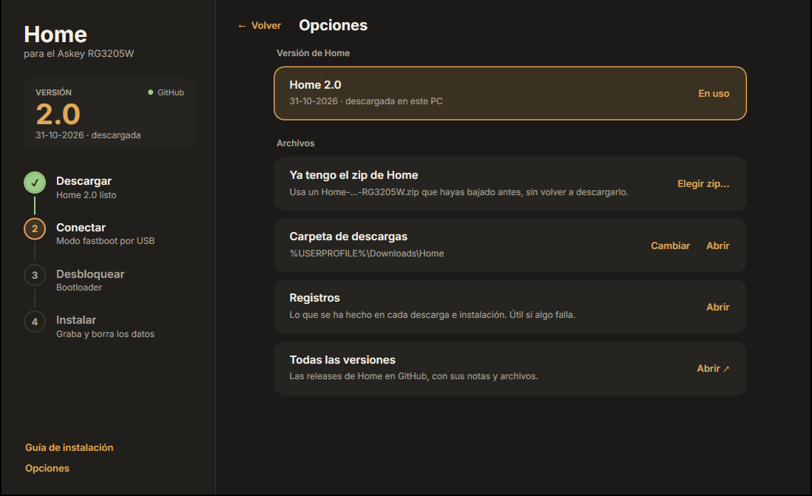
</p>

</details>

<details>
<summary>📋 <b>Requisitos</b></summary>
<br>

- Windows 10/11 de 64 bits con .NET Framework 4.8 (ya viene con Windows)
- Internet para descargar Home, fastboot y el driver · ~4 GB libres
- Askey RG3205W (Rev4 o Rev5) + cable ([cuál necesitas](https://github.com/daniel1286/home-rom-rg3205w/blob/main/guias/INSTALAR.md#2-saber-si-es-rev4-o-rev5-y-conectarlo-al-pc))

</details>

<details>
<summary>🔒 <b>Qué toca y qué no</b></summary>
<br>

- Solo graba `boot`, `recovery`, `vendor`, `system` y `splash`, y solo formatea `cache` y `userdata`
- Comprueba que es un RG3205W, que sigue siendo el mismo y que está desbloqueado
- No graba nada si SHA256 o tamaño no cuadran
- Nunca reinicia la Askey ni rebloquea el bootloader
- Guarda lo suyo en `%LOCALAPPDATA%\Home\Instalador` · Home en `Descargas\Home`

</details>

<details>
<summary>❓ <b>Preguntas frecuentes</b></summary>
<br>

**¿Por qué sale «Windows protegió su PC»?**
Sale con programas poco descargados sin firma comercial. Comprueba SHA256 de cada [release](https://github.com/daniel1286/home-instalador-rg3205w/releases/latest):
```powershell
Get-FileHash .\Instalar-Home.exe -Algorithm SHA256
```

**¿Necesito ejecutar como administrador?**
No. Solo pide elevación para el driver USB.

**¿Cómo lo quito?**
Borra `Instalar-Home.exe` y `%LOCALAPPDATA%\Home\Instalador`.

**Algo ha fallado.**
Abre una [incidencia](https://github.com/daniel1286/home-instalador-rg3205w/issues/new/choose) con el log de **Opciones → Registros**.

**¿Puedo hacerlo a mano?**
Sí → [guía manual](https://github.com/daniel1286/home-rom-rg3205w/blob/main/guias/INSTALAR.md).

</details>

<details>
<summary>🔨 <b>Compilar</b></summary>
<br>

Con el compilador de C# de Windows (.NET Framework 4.8):

```
compilar.cmd
```

Resultado en `salida\Instalar-Home.exe`. GitHub Actions lo compila en cada push; una tag `vX.Y` publica la release.

Modo demo (sin aparato):
```
set INSTALADOR_DEMO=instalando
salida\Instalar-Home.exe
```

| Archivo | Qué hace |
|---|---|
| `fuente/Programa.cs` | Arranque y una sola instancia |
| `fuente/Ventana.xaml` · `Ventana.cs` | La ventana y su aspecto |
| `fuente/Pantallas.cs` · `Acciones.cs` | Pantallas y botones |
| `fuente/Trabajos.cs` | Descargar, driver, desbloquear, instalar |
| `fuente/Red.cs` | Releases y descargas con reanudación |
| `fuente/Imagenes.cs` | Descomprimir y comprobar imágenes |
| `fuente/Fastboot.cs` | Buscar y lanzar fastboot |
| `fuente/Guia.cs` · `Piezas.cs` | Guía de instalación |
| `fuente/Rutas.cs` · `Estado.cs` | Rutas y estado compartido |

</details>

---

# Inalámbrico (Raspberry Pi)

Sin abrir el aparato ni conectar cables. Una Raspberry Pi hace de backend local: el dispositivo se conecta a su WiFi, recibe la actualización y arranca con Home. **Todo automático.**

<p align="center">
  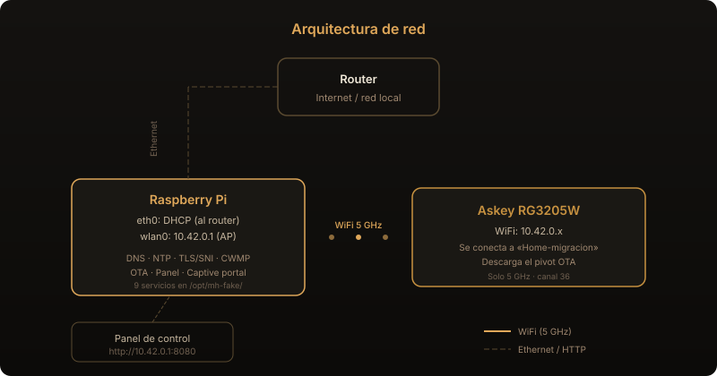
</p>

<details>
<summary>🔄 <b>Ver el proceso paso a paso</b></summary>
<br>

Tras un factory reset, el dispositivo intenta hablar con los servidores originales — pero la Pi responde en su lugar: resuelve todos los dominios hacia sí misma, sirve las APIs que el firmware espera y le entrega un OTA pivot (un recovery mínimo de ~1 MB). El dispositivo lo instala, reinicia en ese recovery y desde ahí descarga e instala el Home ROM completo. Dos fases, las dos automáticas.

<p align="center">
  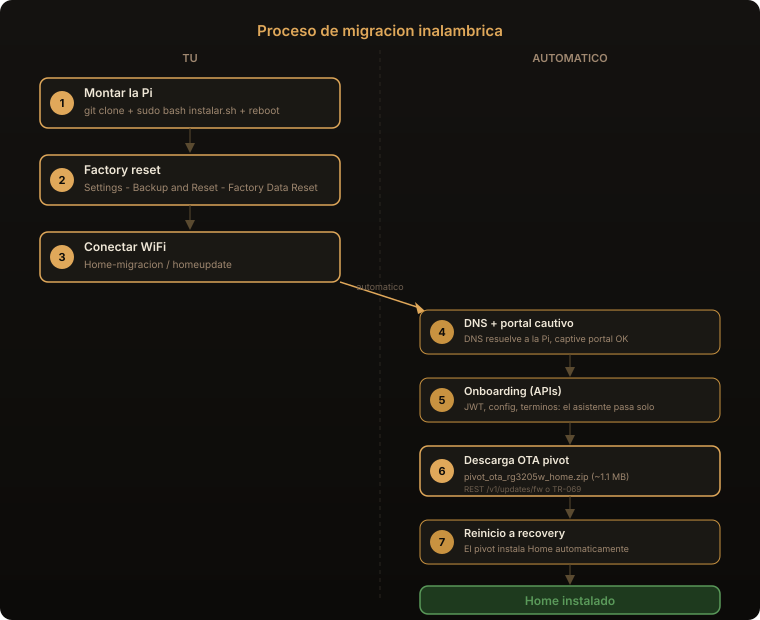
</p>

</details>

### ⚙️ Montar la Pi

**1.** Instala Raspberry Pi OS en la SD y conecta la Pi al router por ethernet

**2.** Clona e instala:

```bash
git clone https://github.com/daniel1286/home-instalador-rg3205w.git
cd home-instalador-rg3205w/inalambrico
sudo bash instalar.sh
```

> [!NOTE]
> El script instala paquetes, configura el WiFi 5 GHz, genera certificados TLS, monta los 9 servicios del backend y descarga los archivos OTA de Releases.

**3.** Reinicia: `sudo reboot` — el backend arranca solo.

### 📱 Migrar el dispositivo

| Paso | Qué hacer |
|:---:|---|
| **1** | 🔄 Factory reset → _Settings → Backup & Reset → Factory Data Reset_ |
| **2** | 📶 Conectar WiFi → Red: **`Home-migracion`** · Clave: **`homeupdate`** |
| **3** | ⏳ Automático — descarga OTA, reinicia, instala Home |

<details>
<summary>🖥️ <b>Panel de control</b></summary>
<br>

Desde cualquier navegador en la red de la Pi:

> **http://10.42.0.1:8080**

Muestra servicios activos, dispositivo conectado, progreso de la OTA y log en tiempo real.

</details>

<details>
<summary>🔧 <b>Servicios y configuración</b></summary>
<br>

9 servicios que arrancan automáticamente con la Pi:

| Servicio | Puerto | Función |
|---|---|---|
| `hostapd` | wlan0 | AP WiFi 5 GHz (canal 36) |
| `dnsmasq` | 53 | DNS → redirige dominios al backend + DHCP |
| `mh-sni` | 443 | TLS/SNI → APIs del firmware (77 endpoints) |
| `mh-captive` | 80 | Captive portal → responde 204 |
| `mh-ntp` | 123/UDP | NTP → fecha fija para certificados |
| `mh-cwmp` | 7016 | TR-069 TLS → entrega OTA al dispositivo |
| `mh-cwmp-http` | 7006 | TR-069 HTTP → fallback |
| `mh-ota` | 8000 | Servidor HTTP de archivos OTA |
| `mh-panel` | 8080 | Panel web de control |

**Configuración** → `/etc/default/mh-fake`:

| Variable | Valor | Qué hace |
|---|---|---|
| `MH_MODE` | `ota` | Modo normal: entrega OTA pivot + Home ROM |
| `MH_MODE` | `onboarding` | Solo pasa el asistente (para pruebas) |

Cambiar de modo:
```bash
sudo sed -i 's/MH_MODE=.*/MH_MODE=onboarding/' /etc/default/mh-fake
sudo systemctl restart mh-sni mh-cwmp mh-cwmp-http
```

SSID/clave WiFi → `/etc/hostapd/hostapd.conf` → `sudo systemctl restart hostapd`

</details>

<details>
<summary>📋 <b>Requisitos</b></summary>
<br>

- **Raspberry Pi 3B+ o superior** con WiFi 5 GHz (el RG3205W solo conecta en 5 GHz)
- **Raspberry Pi OS** (Lite vale)
- **Cable ethernet** al router (solo durante la instalación de la Pi)
- Los archivos OTA se descargan solos con el script, o desde [Releases](https://github.com/daniel1286/home-instalador-rg3205w/releases)

</details>

<details>
<summary>📂 <b>Estructura de archivos</b></summary>
<br>

```
inalambrico/
├── instalar.sh                 script de instalación
└── backend/
    ├── sni_server.py           TLS/SNI (77 endpoints)
    ├── cwmp_server.py          ACS TR-069 (entrega OTA en 2 fases)
    ├── captive_server.py       portal cautivo
    ├── ota_server.py           servidor HTTP para OTAs
    ├── ntp_server.py           servidor NTP
    ├── generate_certs.py       generador de certificados
    ├── panel_server.py         panel web
    ├── panel.html              interfaz del panel
    ├── run-sni.sh              lanzador SNI
    ├── run-cwmp.sh             lanzador ACS TLS
    ├── run-cwmp-http.sh        lanzador ACS HTTP
    ├── config/
    │   ├── hostapd.conf        AP WiFi 5 GHz
    │   ├── dnsmasq.conf        DNS + DHCP
    │   └── backend.default     variables de entorno
    └── systemd/                unidades de servicio
```

En la Pi todo se instala en `/opt/mh-fake/` · Certificados en `/opt/mh-fake/certs/` · OTAs en `/opt/mh-fake/otas/`

</details>

<details>
<summary>❓ <b>Preguntas frecuentes</b></summary>
<br>

**¿Qué modelos de Pi sirven?**
Cualquiera con WiFi 5 GHz: Pi 3B+ (ac), Pi 4, Pi 5. La Pi 3B y Pi Zero **no** (solo 2.4 GHz).

**¿Qué es el OTA pivot?**
Una imagen de recovery mínima (~1 MB) que abre la puerta. No es Home — solo prepara el dispositivo para que la Pi le entregue el Home ROM completo automáticamente en una segunda fase.

**¿Necesito internet durante la migración?**
No. Solo al montar la Pi. Después todo funciona en la red local de la Pi sin internet.

**¿Puedo migrar varios dispositivos?**
Sí. Cada factory reset + WiFi inicia el proceso. El backend se reinicia solo entre dispositivos.

**El dispositivo se conecta pero no pasa nada.**
Comprueba los 9 servicios:
```bash
sudo systemctl status mh-sni mh-captive mh-ntp mh-cwmp mh-cwmp-http mh-ota mh-panel hostapd dnsmasq
```
Si alguno falla → `journalctl -u mh-sni -f`

**¿Puedo cambiar el SSID y la clave WiFi?**
Sí → edita `/etc/hostapd/hostapd.conf` → `sudo systemctl restart hostapd`

</details>

---

<details>
<summary><b>Créditos</b></summary>
<br>

- [Inter](https://rsms.me/inter/), de Rasmus Andersson — [SIL Open Font License 1.1](recursos/letras/OFL.txt)
- Fotos de la placa: [zry98/movistar-home-hacks](https://github.com/zry98/movistar-home-hacks)
- fastboot y Google USB Driver se descargan de Google al usarlos

</details>

**[Apache License 2.0](LICENSE)**

<p align="center">
  <sub>Proyecto independiente, sin relación con Askey ni con ningún operador. Todas las marcas pertenecen a sus respectivos propietarios.</sub>
</p>
